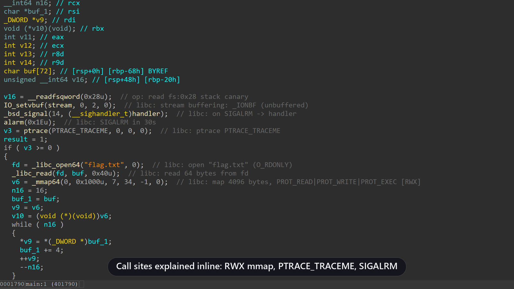

<div align="center">

# IDA Better Reverse

**Identify the libc inside a stripped static binary, name its functions, and read the decompiler output with every library call explained.**

[](https://github.com/FPSZ/ida-better-reverse/releases/latest)
[](LICENSE)


English · [简体中文](README.zh-CN.md)

</div>

<picture>
  <source srcset="docs/demo.avif" type="image/avif">
  
</picture>
<p align="center"><sub>IDA Pro 9.1, stripped static x86-64 binary, one click. <a href="https://github.com/FPSZ/ida-better-reverse/releases/download/v2.1.0/demo.mp4">MP4, 1080p60</a></sub></p>

IDA Better Reverse is an IDA Pro plugin for statically linked, stripped ELF binaries, which
is what most CTF reversing and pwn challenges and a lot of Linux malware look like. It works
out which C runtime build was linked in (glibc or musl, down to the release) and names the
library functions with FLIRT signatures generated for that exact build. It also restores their
prototypes and annotates the Hex-Rays output with what each libc call and system call does,
with constants decoded. The plugin is a single Python file with its data embedded. The same
file runs as a command-line tool without IDA.

## Example

Hex-Rays on the stripped binary from the recording above:

```c
  sub_405110(off_4AA6D0, 0, 2, 0);
  sub_404600(14, sub_4019C0);
  sub_4195B0(30);
  v5 = sub_41A310(0, 0, 0, 0, v3, v4, v20[0]);
  result = 1;
  if ( v5 >= 0 )
  {
    v7 = sub_419640("flag.txt", 0, v20[0]);
    sub_419760(v7, v20, 64);
    v8 = sub_41A1F0(0);
```

After **Run** (detect, apply signature, apply prototypes). The comments are drawn by a
decompiler hook as the function is printed and are not stored in the database:

```c
  IO_setvbuf((FILE *)stream, 0, 2, 0);  // libc: stream buffering: _IONBF (unbuffered)
  _bsd_signal(14, (__sighandler_t)sub_4019C0);  // libc: on SIGALRM -> sub_4019C0
  alarm(0x1Eu);  // libc: SIGALRM in 30s
  v3 = ptrace(PTRACE_TRACEME, 0, 0, 0);  // libc: ptrace PTRACE_TRACEME
  result = 1;
  if ( v3 >= 0 )
  {
    fd = _libc_open64("flag.txt", 0);  // libc: open "flag.txt" (O_RDONLY)
    _libc_read(fd, buf, 0x40u);  // libc: read 64 bytes from fd
    v6 = _mmap64(0, 0x1000u, 7, 34, -1, 0);  // libc: map 4096 bytes, PROT_READ|PROT_WRITE|PROT_EXEC [RWX]
    ...
    v11 = syscall(39, buf_1);  // sys: getpid (#39)
```

From the command line, on a 2024 强网杯 challenge whose ELF header was tampered with to
break `file`/`readelf`:

```console
$ python ida_better_reverse.py remem
target    : remem
type      : linux / static / x86_64
build-id  : f522110408101510e7e36e66dedffe341035255d
------------------------------------------------------------
version ranking (hit-rate  hits/anchors):
  glibc 2.35     25.7%  381/1480  #######
  glibc 2.34     21.9%  323/1474  ######
  glibc 2.33     19.8%  247/1250  #####
  glibc 2.32     18.9%  235/1243  #####
  glibc 2.31     16.7%  212/1272  #####
------------------------------------------------------------
verdict   : glibc 2.35   confidence = high
  - ELF ident bytes tampered: EI_CLASS/EI_DATA claim 32-bit big-endian, header decodes as 64-bit little-endian x86_64.
  - toolchain: gcc 11.4.0 (Ubuntu 11.4.0-1ubuntu1~22.04)
  - static (x86_64): function byte-anchor match; clear leader = most likely build.
  - lead over #2: 3.8 pts (x1.17).
  - toolchain cross-check: agrees.
```

## The problem

FLIRT can name the libc functions in a static binary, but only with signatures built from
the same libc release, and a stripped static binary rarely tells you which release that is.
The usual workaround is to apply dozens of signature files and hope. Even with the right
release there is a second problem. Signatures generated from `libc.a` with `pelf` describe
the code as it sits in the object files, and static linking changes some of those bytes. On
AArch64, signatures built the straightforward way name only 37% of the functions in our test
binary (see [Evaluation](#evaluation)).

## How it works

### Identifying the runtime

1. **Container.** Static versus dynamic is decided from the ELF program headers
   (`PT_INTERP`, `DT_NEEDED`), not from strings, so shared objects and static-pie binaries are
   classified correctly. When `EI_CLASS`/`EI_DATA` have been tampered with (the binary still
   runs, but `file` and `readelf` give up), the header is decoded in whichever layout yields
   a valid machine and file type.
   Dynamic binaries get a `GLIBC_2.x` lower bound from symbol versions and their build-id.
2. **Fingerprints.** For each of 29 builds per architecture (glibc 2.19–2.44 and musl
   1.1.24 and 1.2.2–1.2.6, from Ubuntu and Alpine packages), every function's leading 32-byte
   FLAIR pattern contributes its longest wildcard-free run of 10–24 bytes as an *anchor*.
   Bytes the linker fills in or rewrites are wildcarded first, so an anchor never spans them
   (see the next section). The result is 12–14 k distinct anchors per architecture, embedded
   in the plugin in compressed form.
3. **Lookup.** Each anchor is indexed by its *rarest* 8-byte window, the one that occurs in
   the fewest anchors. A single pass over the executable bytes does one dictionary probe per
   offset and verifies the few candidates. The x86-64 index has 11,568 keys, with at most 7
   anchors behind any key. This is pure Python with no dependencies.
4. **Decision.** Each build is scored by the fraction of its anchors present in the target.
   A static binary links only the part of libc it uses, so absolute rates sit around 20–40%.
   Confidence therefore comes from the margin over the runner-up. If the binary's `.comment`
   records a distribution toolchain (e.g. `GCC (Ubuntu 11.4.0-1ubuntu1~22.04)`), the release
   it implies is used as an independent cross-check.

### Signatures that match linked code

`pelf` wildcards the bytes a relocation fills in, judged by looking at the object file. A
static link changes more than that:

| Arch | In `libc.a` | In the linked binary | Bytes `pelf` leaves literal |
|---|---|---|---|
| x86-64 | `mov rcx, [rip+__libc_errno@gottpoff]` &nbsp;`48 8B 0D` | `mov rcx, -0x40` &nbsp;`48 C7 C1` | REX, opcode, ModRM |
| AArch64 | `adrp x0, sym` &nbsp;pattern `......90` | `600400F0` | top byte (`immlo`, bits 29–30) |
| AArch64 | `ldr x0, [x0, #:lo12:sym]` &nbsp;pattern `....40F9` | `002446F9` | byte holding the high bits of `imm12` |

The first row is the initial-exec → local-exec TLS relaxation, which reaches most syscall
wrappers (`read`, `mmap`, `ptrace`, `alarm`, …) through `errno`. The AArch64 rows are relocated
immediates that `pelf` wildcards only partially, so the pattern matches only when those bits
happen to be zero. [`tools/flair_relax.py`](tools/flair_relax.py) rewrites the patterns
before `sigmake` runs:
- it wildcards the instruction bytes around references to the archive's `STT_TLS` symbols
  and drops the CRC when one of them falls inside the CRC range;
- it wildcards every AArch64 instruction word that `pelf` left partly wildcarded.

[`tools/make-sigs.py`](tools/make-sigs.py) then removes patterns with fewer than 10 fixed bytes. One
of them, the AArch64 `_dl_start` pattern, is a bare `stp x29, x30, [sp,#-16]!; mov x29, sp`
prologue that FLIRT would otherwise stamp on unrelated functions. Byte-identical modules
(`strtol`/`strtoul`, `fseek`/`fseeko`) are excluded rather than guessed. Precision comes first.

### Types and annotations

Once functions have names, their prototypes are pulled from IDA's own type libraries
(`gnulnx_*`). A `Hexrays_Hooks.func_printed` hook walks the ctree of the function being
displayed and attaches notes to call sites by ctree item. Fortified `__*_chk` and
`__isoc99_*` variants are read as the call they wrap, and the arguments are decoded with the
call's actual values:
- `open` flags, `mmap`/`mprotect` protections (with an RWX warning), signal numbers;
- `ptrace`/`prctl` requests, socket families, `lseek` whence, standard fds;
- format strings, and `syscall(n)` resolved through per-architecture kernel tables.

The notes follow renames and language changes and write nothing. Persisting them, and every
other change the plugin makes (names, types, library flags, comments), goes through an undo
journal. On the demo binary, no name, type or library flag differs from the original after
**Undo**.

## Evaluation

All numbers below were measured on the shipped data with IDA Pro 9.1 (idalib) and Python 3.14
on an AMD Ryzen AI MAX+ 395.

### Function naming against ground truth

Two small C programs were built with Ubuntu 24.04's GCC 13.3 against glibc 2.39 using
`-static`, then stripped. IDA analysed the stripped binary and one signature was applied.
Every function IDA marked as library code was compared with all symbols at that address in
the unstripped build; aliases such as `read`/`__read`/`__libc_read` count as correct, and
IDA's placeholder names (`unknown_libname_N`) do not count as named. The baseline is the same
pipeline without the pattern rewriting and the weak-pattern filter.

| Target | Signatures | Named | Correct | Precision | Coverage¹ |
|---|---|--:|--:|--:|--:|
| x86-64 | `pelf` → `sigmake` | 810 | 804 | 99.3% | 82.4% |
| x86-64 | **this project** | **856** | **855** | **99.9%** | **86.9%** |
| i386 | `pelf` → `sigmake` | 751 | 750 | 99.9% | 79.4% |
| i386 | **this project** | **750** | **749** | **99.9%** | **79.3%** |
| AArch64 | `pelf` → `sigmake` | 330 | 294 | 89.1% | 37.3% |
| AArch64 | **this project** | **501** | **495** | **98.8%** | **62.7%** |

<sub>¹ Correctly named ÷ functions that have a symbol in the unstripped build (976–984,
945 and 789). The denominator includes crt and libgcc code (`_start`, `frame_dummy`,
the unwinder) that no libc signature can name, and byte-identical modules that are
deliberately left unnamed. On i386 the rewriting changed no patterns, so its row only shows
the effect of the weak-pattern filter.</sub>

### Runtime identification on CTF binaries

These are all 19 ELF and PE files from the 强网杯 (QWB) 2023–2025 reverse-engineering
challenges, 63.6 MB in total:

| Class | Files | Result |
|---|--:|---|
| Static x86-64 glibc | 5 | glibc 2.31, 2.35 (×3), 2.39. Two of the five have tampered ELF headers. All four that carry a GCC/Ubuntu toolchain string agree with it. |
| Dynamic ELF, incl. a 41 MB shared object | 7 | Classified dynamic, with a `GLIBC_2.x` lower bound |
| Windows PE | 6 | MSVC (Rich header), MinGW and .NET recognised |
| Static MIPS | 1 | Reported as unsupported, no verdict |

None was misclassified. The three ground-truth binaries above (x86-64, i386, AArch64) are
all identified as glibc 2.39 with high confidence.

### Speed

| Run | Input | Time |
|---|---|--:|
| CLI | `emu`, static x86-64, 12.7 MB | 0.57 s |
| CLI | `iked`, static x86-64, 4.5 MB | 0.43 s |
| CLI | `butterfly`, static x86-64, 0.7 MB | 0.23 s |
| CLI | all 19 binaries above, 63.6 MB | 2.0 s |
| In IDA | `emu`, 13,861 functions | 0.54 s |

## Install

1. Download `ida_better_reverse.py` and `ibr-sigs.zip` from the
   [latest release](https://github.com/FPSZ/ida-better-reverse/releases/latest).
2. Copy `ida_better_reverse.py` into your IDA user directory's `plugins/`, then unzip
   `ibr-sigs.zip` into that same user directory (it contains `sig/pc/` and `sig/arm/`):

   | OS | IDA user directory |
   |---|---|
   | Windows | `%APPDATA%\Hex-Rays\IDA Pro\` |
   | Linux / macOS | `~/.idapro/` |

3. Restart IDA, open a binary, and press **Ctrl-Alt-G**.

IDA Pro 7.4–9.x with Python 3. The panel uses PySide6 (IDA 9) or PyQt5 and falls back to a
native form. Annotations need the Hex-Rays decompiler; detection and FLIRT do not. Nothing
leaves the machine: the plugin opens no network connections.

## Usage

The panel shows the detection result with the candidate ranking and offers:

| Option | Effect |
|---|---|
| **Live annotations** | Decompiler notes, rendered on display, nothing written (on by default) |
| **Apply FLIRT signature** | Apply the signature for the detected build plus libc prototypes |
| **Describe libc functions** | A one-line description as the function comment of each named libc function |
| **Persist comments** | Write the current function's notes into the database |
| **Math / SIMD in disassembly** | `xor eax, ebx` → `eax = eax ^ ebx`, SSE/AVX intrinsics spelled out |

**Detect** ranks candidates, **Run** applies the checked options, and **Undo** reverts
everything the plugin wrote. The UI and the notes are available in English and Chinese.

As a command-line tool, with no IDA required:

```console
$ python ida_better_reverse.py ./target                  # ranked candidates and verdict
$ python ida_better_reverse.py ./target --top 8 --json   # machine-readable
$ python ida_better_reverse.py ./target --arch aarch64   # override a broken e_machine
```

## Rebuilding the data

Everything is generated from public distribution packages. You need Hex-Rays FLAIR
(`pelf`, `sigmake`):

```console
python tools/build-db.py --pelf <flair>/pelf      # libc6-dev / musl-dev packages -> _db/<arch>/*.pat
python tools/build-fingerprint.py                 # -> tools/fingerprint.bin
python tools/make-sigs.py --sigmake <flair>/sigmake --install <IDA dir>   # -> _sigs/, 87 .sig files
python tools/gen-syscalls.py > tools/syscalls.json   # optional, needs Linux kernel headers
python tools/embed-fingerprint.py                 # -> ida_better_reverse.py
```

## Limitations

- Static identification needs the build in the database. Libraries compiled by other
  distributions with different flags match less well.
- Only x86-64, i386 and AArch64 are covered; MIPS, 32-bit ARM and RISC-V are not.
- Dynamic binaries get a lower bound, not an exact build; the build-id can pin the exact
  build with [libc.rip](https://libc.rip).
- Library functions that are byte-identical to another one are left unnamed.

## License

[MIT](LICENSE). The fingerprints and signatures are derived from Ubuntu and Alpine glibc/musl
packages with Hex-Rays FLAIR. This project builds on the community FLIRT collection
[`push0ebp/sig-database`](https://github.com/push0ebp/sig-database).
