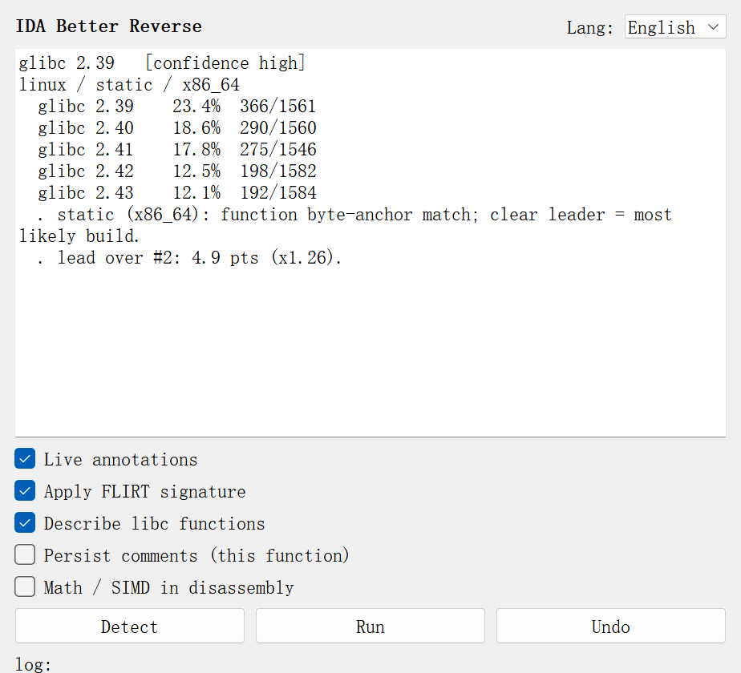
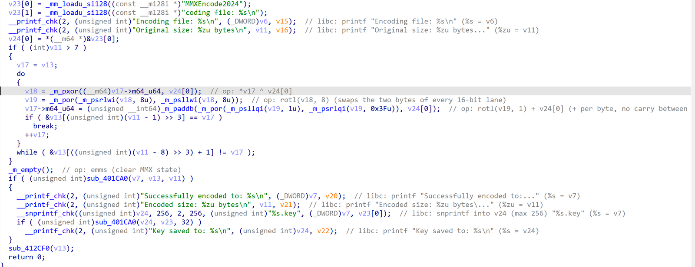
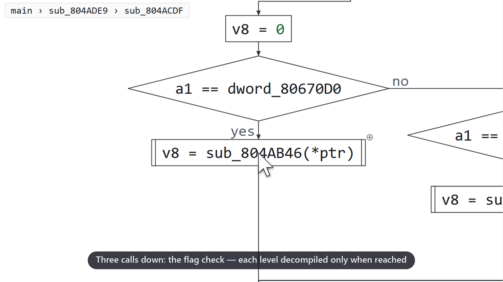
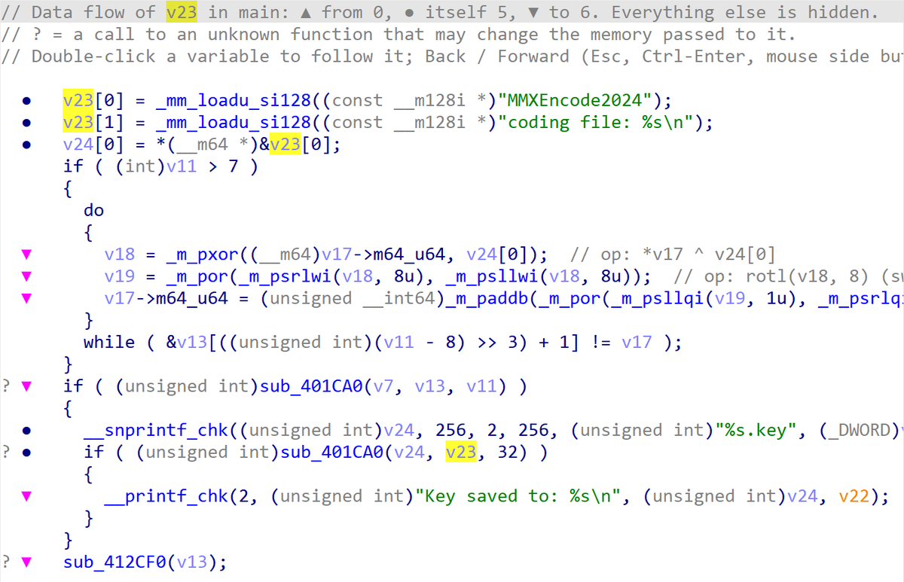
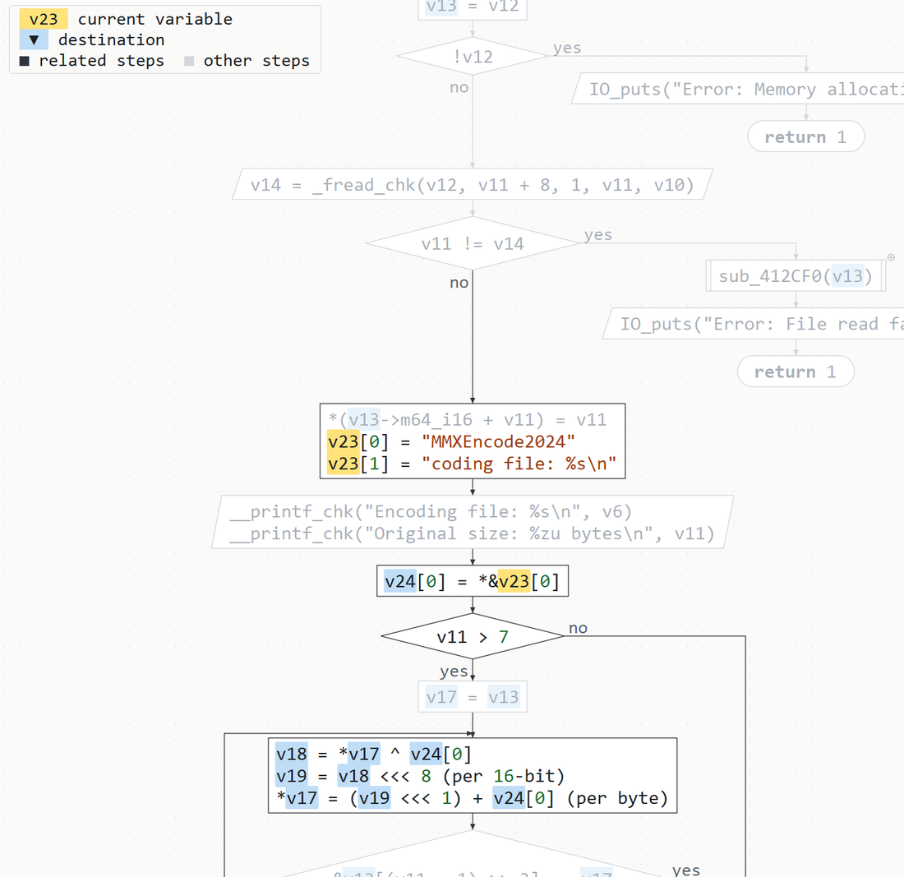
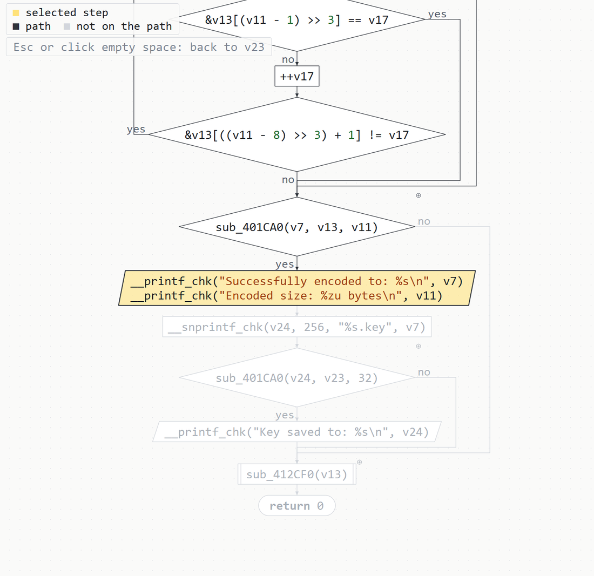
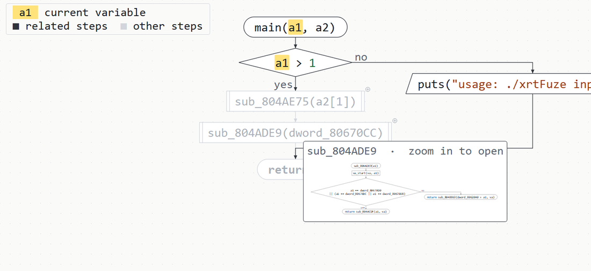
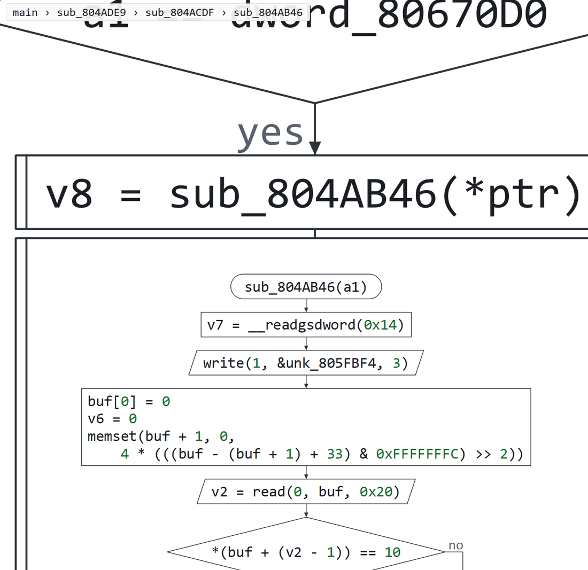
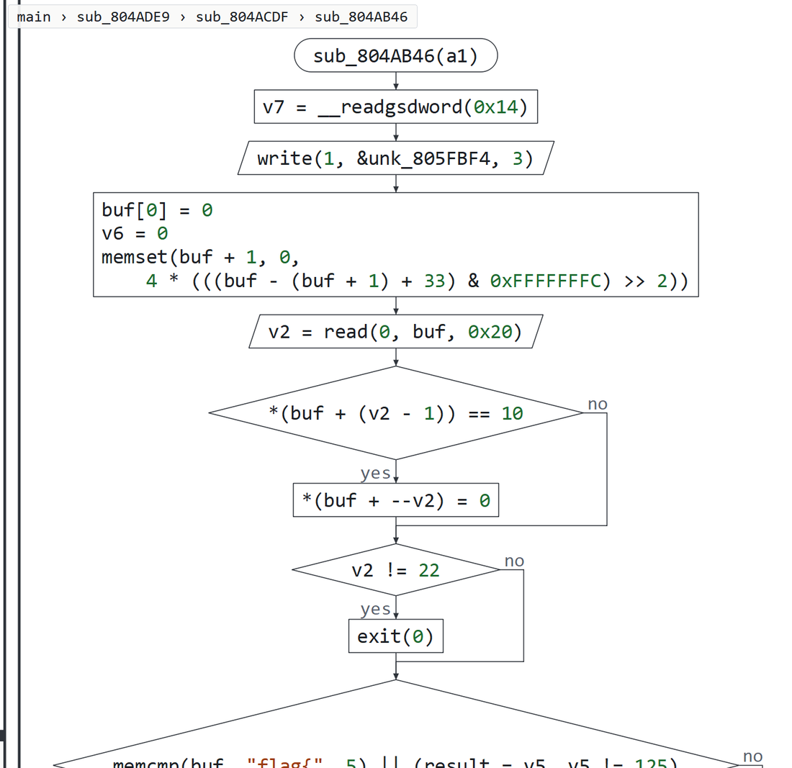

<div align="center">

# IDA Better Reverse

**Name the libc inside a stripped static binary, explain every call in the pseudocode, and read any function as a flowchart you can zoom into, call after call.**

[](https://github.com/FPSZ/ida-better-reverse/releases/latest)
[](LICENSE)


English · [简体中文](README.zh-CN.md)

</div>

<picture>
  <source srcset="docs/demo.avif" type="image/avif">
  
</picture>
<p align="center"><sub>IDA Pro 9.1, stripped static x86-64 binary, one click (recorded with v2.2.0). <a href="https://github.com/FPSZ/ida-better-reverse/releases/download/v2.2.0/demo.mp4">MP4, 1080p60</a> · Data flow and flowcharts have <a href="#data-flow-and-flowcharts">their own video</a>.</sub></p>

IDA Better Reverse is an IDA Pro plugin for the binaries CTF reversing and pwn challenges, and
a lot of Linux malware, are made of: stripped and statically linked. It finds out which C
runtime build was linked in (glibc or musl, down to the release), names the library functions
with FLIRT signatures made for that exact build and for the GCC runtime next to it, and writes
what each libc call and system call does next to it in the Hex-Rays output. Then it helps read
the program's own code: one variable's data flow on its own, and the whole function as a
textbook flowchart in which a call opens into the called function's chart as you zoom into it.
It is plain Python with its data included; the entry file also runs as a command-line tool
without IDA.

## Names and notes

### Names the libc, from the bytes

A stripped static binary calls `sub_4776D0` where the source called `printf`. **Detect** ranks
glibc and musl builds by how many of their functions' byte fingerprints occur in the binary;
**Run** applies FLIRT signatures generated for the winning build and for its GCC runtime, and
gives the named functions their prototypes. On Butterfly: glibc 2.39, 838 functions named,
143 prototypes, one click.

<p align="center"></p>

### Explains every call

A decompiler hook writes, next to each call, what it does with the values it is actually given:
`open` flags, `mmap` protections (RWX flagged), signals, `ptrace` requests, socket types, printf
and scanf conversions bound to their arguments, `syscall(n)` with the call named per
architecture. MMX/SSE/AVX intrinsic chains are folded into one plain expression with the lane
rules that make them differ from scalar code. The notes are drawn as the function is printed and
are not stored in the database.

<p align="center"></p>

## Data flow and flowcharts

<picture>
  <source srcset="docs/flow.avif" type="image/avif">
  
</picture>
<p align="center"><sub>IDA Pro 9.1, real recording: Butterfly (QWB 2025), then three calls deep in xrtFuze (QWB 2023). <a href="https://github.com/FPSZ/ida-better-reverse/releases/download/v2.4.0/flow.mp4">MP4, 1080p60</a></sub></p>

### Follows one variable

**Ctrl-Alt-F** on a variable (or a global) opens a window with only the lines its value comes
from (▲), the lines that read or write it (●) and the lines it goes to (▼), inside the
if/loop headers around them; everything else is hidden. It follows values through memory:
reaching definitions over the function's control flow, points-to per object, pointer copies,
and calls that write through their arguments (`fread`, `memcpy`, an unknown `encrypt(buf, out)`).
Double-click a variable to follow it instead; Esc goes back.

<p align="center"></p>

### Draws the function as a flowchart

**Space** turns the window into the whole function drawn the way textbooks draw a program:
statements in order, conditions as diamonds with yes/no exits, input and output as
parallelograms, calls of the program's own functions with double sides, loops back on the
left and out on the right, error branches in a column of their own. Arithmetic is written as
math (`v19 <<< 1`, `(per byte)`), not as intrinsics. The followed variable is marked yellow,
what is computed from it blue (▼) and what it is computed from purple (▲); the lines that
have nothing to do with it are faded, and a legend says which is which. Click a step to light
the path that leads to it.

<p align="center">
  
  
</p>

### Opens calls as you zoom in

Every call of one of the program's own functions carries a ⊕. Rest the mouse on it and a small
picture of the called function's chart appears. Zoom into the call and that chart opens under
it, drawn to fit; zoom further and the calls inside open the same way, as deep as you go. A
breadcrumb in the legend says where you are. When the followed value is handed to the call,
the argument it arrives in is followed inside. Nothing is decompiled until a call is zoomed
into, one function per turn of the event loop, and a chart is dropped again when you zoom out.

<p align="center">
  
</p>
<p align="center">
  
  
</p>

## Evaluation

All numbers were measured with IDA Pro 9.1 (idalib and GUI) on an AMD Ryzen AI MAX+ 395.

### Function naming against ground truth

Two small C programs were built for x86-64, i386 and AArch64 with Ubuntu 24.04's GCC 13.3
against glibc 2.39 using `-static`, and stripped. Signatures were applied to the stripped binary, again until a pass
named nothing new; every name was checked against all symbols at that address in the
unstripped build (aliases such as `read`/`__read`/`__libc_read` count). Coverage is correct
names over all functions in the unstripped symbol table, precision is correct over named.

| Binary (functions) | IDA alone | IDA 9.1 `ubuntu-libc6-dev` | IDA 9.1 `debian-libc6-dev` | This project, libc | This project, libc + libgcc |
|---|--:|--:|--:|--:|--:|
| x86-64 (1,059) | 0 | 71.6% · 93.3% | 0.5% · 31.3% | 80.8% · 99.9% | **85.2% · 99.9%** |
| i386 (993) | 0 | 18.1% · 87.4% | 64.8% · 90.7% | 78.9% · 99.9% | **86.4% · 99.9%** |
| AArch64 (911) | 0 | 39.2% · 89.5% | 25.8% · 76.3% | 55.9% · 98.6% | **65.4% · 98.8%** |

<sub>Each cell is coverage · precision. IDA applies no libc signature to these binaries by itself.
Its own signatures merge several releases, so the one to pick depends on the distribution
(Ubuntu's is far better on x86-64, Debian's on i386), and their errors are mostly look-alike
stubs, `.cold` fragments and code from other releases. The denominators include functions no
libc signature can name (`main`, the program's own code, CRT start-up). These programs were
built against glibc 2.39, the release our signatures were picked for; IDA's cover several.
Raw results: `devtools/eval_flirt.py`.</sub>

### Runtime identification on CTF binaries

All 19 ELF and PE files of the 强网杯 (QWB) 2023–2025 reverse-engineering challenges, 63.6 MB:

| Class | Files | Result |
|---|--:|---|
| Static x86-64 glibc | 5 | glibc 2.31, 2.35 (×3), 2.39; two of them with tampered ELF headers. All four that carry a GCC/Ubuntu toolchain string agree with it. |
| Dynamic ELF, incl. a 41 MB shared object | 7 | Classified dynamic, with a `GLIBC_2.x` lower bound |
| Windows PE | 6 | MSVC (Rich header), MinGW and .NET recognised |
| Static MIPS | 1 | Reported as unsupported, no verdict |

None was misclassified. The command line identifies all 19 in 2.0 s.

### Flowcharts on real challenges

For seven QWB challenges, the 40 largest functions of each (238 functions) were charted and
every variable of each (up to 40, 4,500 in all) was followed: no error, no two shapes
overlapping, no line through a shape. The largest function, 2,089 pseudocode lines, took at
most 1.5 s to chart and 1.7 s to follow another variable. The test suite lays out 150 random
function shapes with the same checks. Opening calls was exercised three calls deep in xrtFuze
and in ez_vm (QWB 2024, a 2,000-line VM loop); a called function's chart took 11–41 ms to make.

### Undo

Every change the plugin writes (names, types, library flags, comments) goes through a journal.
On 36 headless configurations (the files above, test programs in both UI languages, the
ground-truth binaries), **Undo** left behind nothing the plugin had written; the only
differences were types Hex-Rays itself inferred while decompiling. The data-flow and flowchart
windows write nothing.

## How it works

**Fingerprints.** For each of 29 builds per architecture (glibc 2.19–2.44, musl 1.1.24 and
1.2.2–1.2.6, from Ubuntu and Alpine packages), every function's leading FLAIR pattern gives its
longest wildcard-free run of 10–24 bytes. The 12–14 k anchors per architecture are indexed by
their rarest 8-byte window, so one pass over the executable bytes does one dictionary probe per
offset. A build's score is the fraction of its anchors present; confidence comes from the margin
over the runner-up and is cross-checked against a toolchain string in `.comment`. Static versus
dynamic comes from the program headers, and a tampered `EI_CLASS`/`EI_DATA` is decoded in
whichever layout gives a valid machine.

**Signatures that match linked code.** `pelf` wildcards what a relocation fills in, judged from
the object file, but static linking rewrites more:

| Arch | In `libc.a` | In the linked binary | Bytes `pelf` leaves literal |
|---|---|---|---|
| x86-64 | `mov rcx, [rip+__libc_errno@gottpoff]` &nbsp;`48 8B 0D` | `mov rcx, -0x40` &nbsp;`48 C7 C1` | REX, opcode, ModRM |
| AArch64 | `adrp x0, sym` &nbsp;pattern `......90` | `600400F0` | top byte (`immlo`) |
| AArch64 | `ldr x0, [x0, #:lo12:sym]` &nbsp;pattern `....40F9` | `002446F9` | high bits of `imm12` |
| i386 | `mov eax, [ebx+sym@GOT]` &nbsp;`8B 83` | `mov eax, imm32` &nbsp;`C7 C0` | opcode, ModRM |

[`tools/flair_relax.py`](tools/flair_relax.py) wildcards those bytes before `sigmake` runs;
patterns with fewer than 10 fixed bytes and byte-identical modules are left out rather than
guessed. The GCC runtime (`libgcc`, `libgcc_eh`, `crtbeginT.o`) is signed separately for GCC 4.8
to 15 and applied with the libc signature.

**Data flow.** The Hex-Rays ctree is turned into a neutral statement tree. Each statement is a
site with what it reads and writes; reaching definitions run as bit sets over the control flow;
points-to is computed per site, so `p = buf; *p = x` writes `buf`'s memory. Calls are modelled by
what they do with their arguments: `fread` only writes its buffer, `memcpy` copies, an unknown
call may write what it is handed. A slice goes backward to the sources and forward to the uses.

**Flowchart.** The statement tree becomes a structured layout (sequence, if, loops, switch,
break/continue, goto), placed by contours: the main line straight down, a branch that ends
(an error that returns) in a column beside its condition, loops closed on the left. Lines are
routed orthogonally around the shapes. A called chart hangs in a panel under its call, scaled
to its width; how far a call is zoomed into decides when its chart is made, faded in and
dropped.

## Install

1. Download `ida_better_reverse.zip` and `ibr-sigs.zip` from the
   [latest release](https://github.com/FPSZ/ida-better-reverse/releases/latest).
2. Unzip both into your IDA user directory (`%APPDATA%\Hex-Rays\IDA Pro\` on Windows,
   `~/.idapro/` on Linux and macOS). This adds `plugins/ida_better_reverse.py`, the code in
   `plugins/ida_better_reverse/`, and 117 signatures under `sig/pc/` and `sig/arm/`.
3. Restart IDA.

IDA Pro 7.4–9.x with Python 3 (developed and tested on 9.1). The windows use PyQt5 (IDA 9.1 and earlier) or PySide6 (9.2 and
later). Annotations, data flow and flowcharts need the Hex-Rays decompiler; detection and FLIRT
do not. The plugin opens no network connections. Upgrading from 2.3 or earlier: the new entry
file replaces the old single `ida_better_reverse.py`.

## Usage

| Where | Key | |
|---|---|---|
| Anywhere | **Ctrl-Alt-G** | The panel: **Detect**, **Run** (signatures, prototypes, notes), **Undo** |
| Pseudocode | **Ctrl-Alt-F** or right-click | Data flow of the variable under the cursor |
| Data flow window | **Space** | Text ⇄ flowchart, in the same place |
| Both | double-click · Esc · Ctrl-Enter · mouse side buttons | Follow a variable · back · forward |
| Flowchart | wheel · drag | Zoom about the mouse (into calls) · move |
| Flowchart | click · Esc | The path to a step · back to the variable |
| Flowchart | double-click a function · Enter | Go to it · jump to the line in the pseudocode |

A local variable double-clicked in the pseudocode is followed by an open data-flow window too.
The UI and the notes are in English and Chinese.

Without IDA (from the unzipped `plugins/` folder or a clone):

```console
$ python ida_better_reverse.py ./target                  # ranked candidates and verdict
$ python ida_better_reverse.py ./target --top 8 --json   # machine-readable
$ python ida_better_reverse.py ./target --repair out     # fix tampered EI_CLASS/EI_DATA so IDA can load it
```

## Building from source

The source is `src/ibr`: `core/` (detection, decoders, layout; no IDA imports), `analysis/`
(data flow, flowchart), `app/` (use cases against `ports.py`), `adapters/` (idaapi, Hex-Rays,
Qt, command line). `python tools/package.py` builds `dist/ida_better_reverse.zip`;
`python -m pytest tests` runs without IDA. The fingerprints and signatures are rebuilt from
public packages with Hex-Rays FLAIR: `tools/build-db.py`, `build-fingerprint.py`,
`make-sigs.py`.

## Limitations

- Static identification needs the build in the database; libraries built by other
  distributions with other flags match less well. Dynamic binaries get a lower bound.
- Runtime identification and signatures cover x86-64, i386 and AArch64. On AArch64 a function
  inside a multi-function object module is named only when the module's first function matches.
- Library functions byte-identical to another are left unnamed.
- Data flow is per function: values passed through globals between functions, or through
  pointers stored in memory by other functions, are not followed across calls.
- An opened call's panel covers the part of the calling chart below it until you zoom out.

## License

The code is [MIT](LICENSE). The fingerprints and signatures are generated with Hex-Rays FLAIR
from public Ubuntu and Alpine packages:

| Library | Packages | License |
|---|---|---|
| glibc | `libc6-dev`, `libc6-dev-i386` | LGPL-2.1-or-later |
| musl | `musl-dev` | MIT |
| GCC runtime | `libgcc-N-dev`, `lib32gcc-N-dev` | GPL-3.0 with the GCC Runtime Library Exception |

They hold function names, checksums and short byte patterns: the first 32 bytes of each function
with relocated bytes wildcarded, plus a few distinguishing bytes where two functions would
otherwise collide, and one 10–24-byte run per function in the fingerprint. No library or
complete function is redistributed; FLAIR is not included. Inspired by the community FLIRT
collection [`push0ebp/sig-database`](https://github.com/push0ebp/sig-database), whose data is
not used here.
