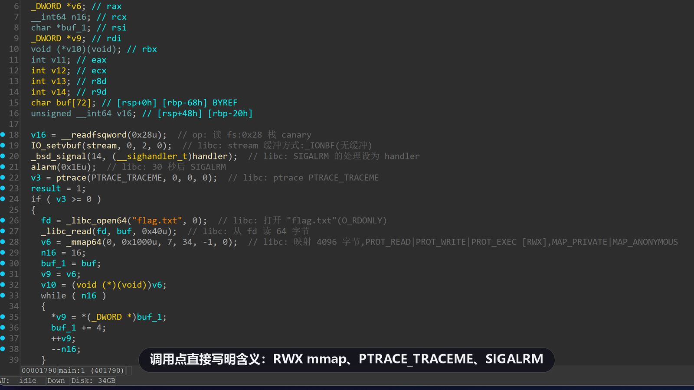
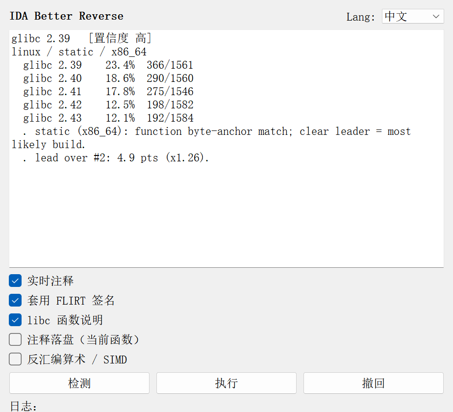
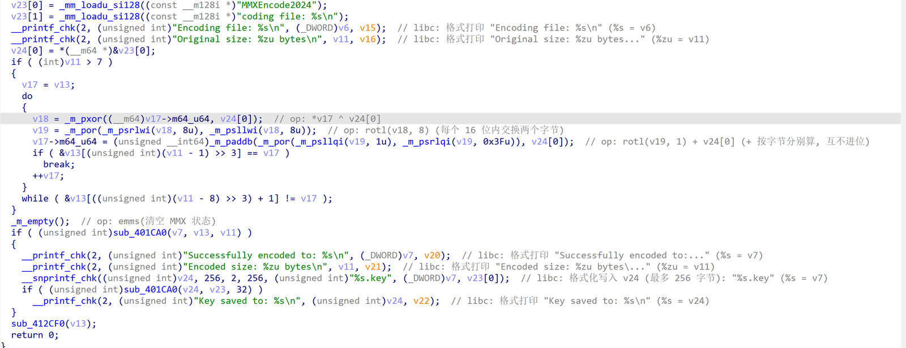
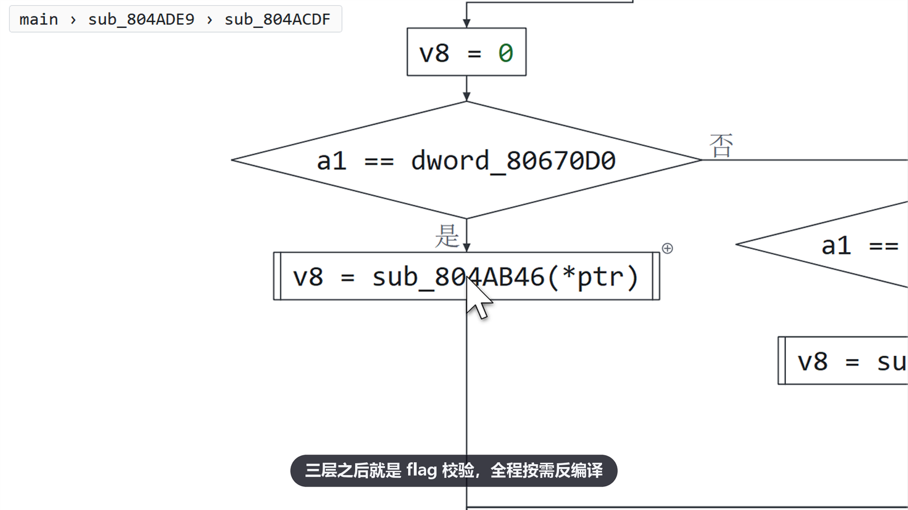
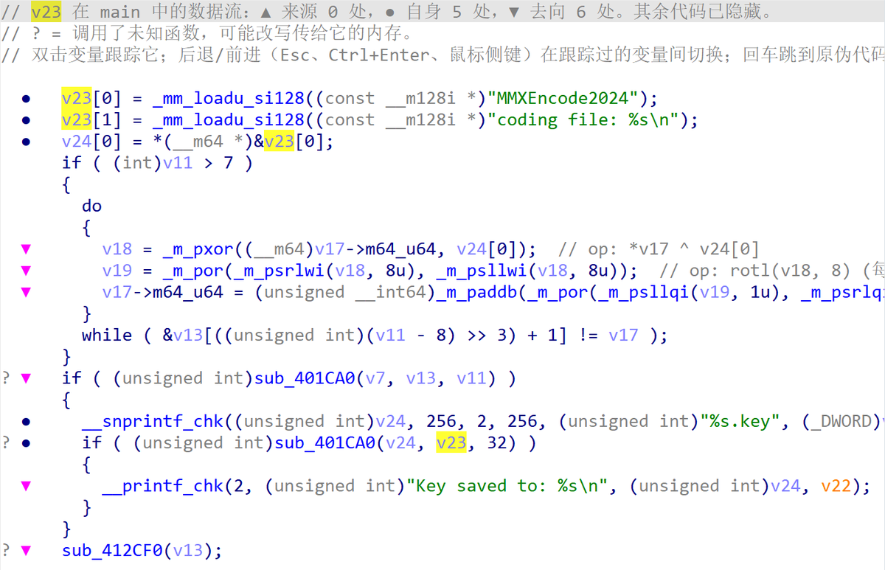
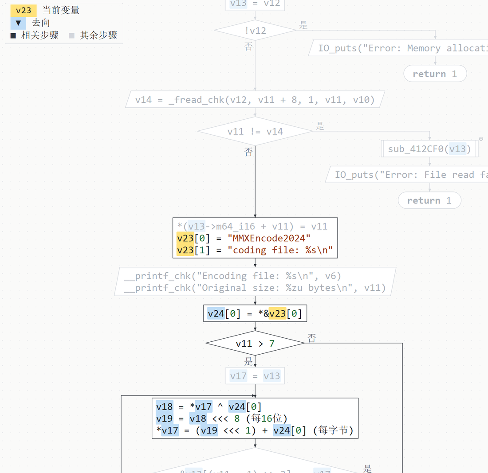
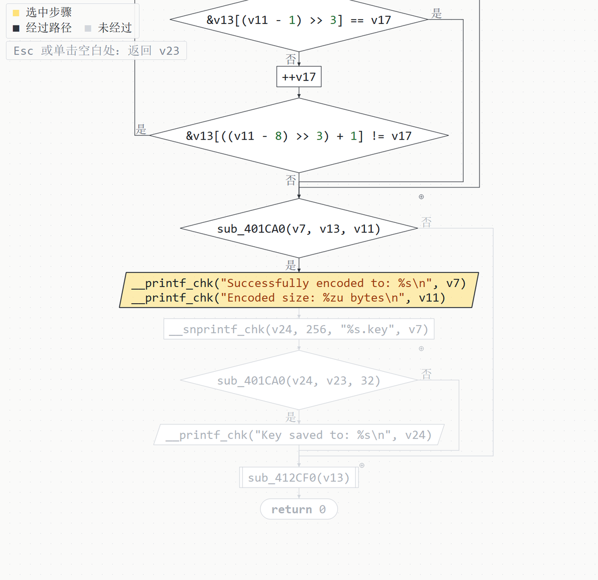
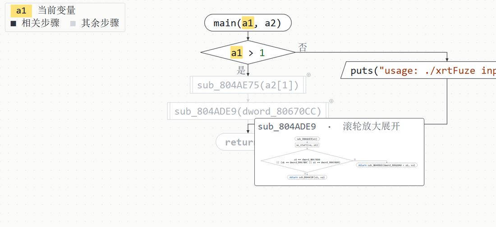
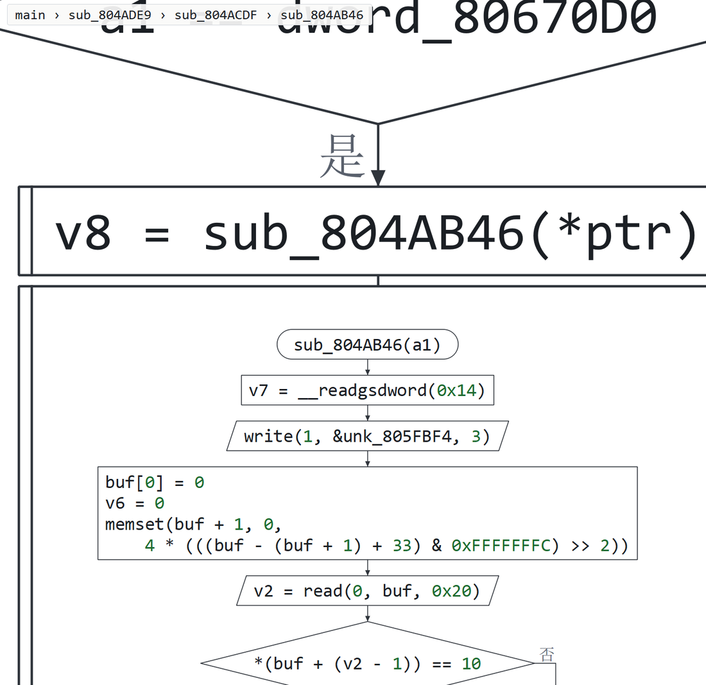
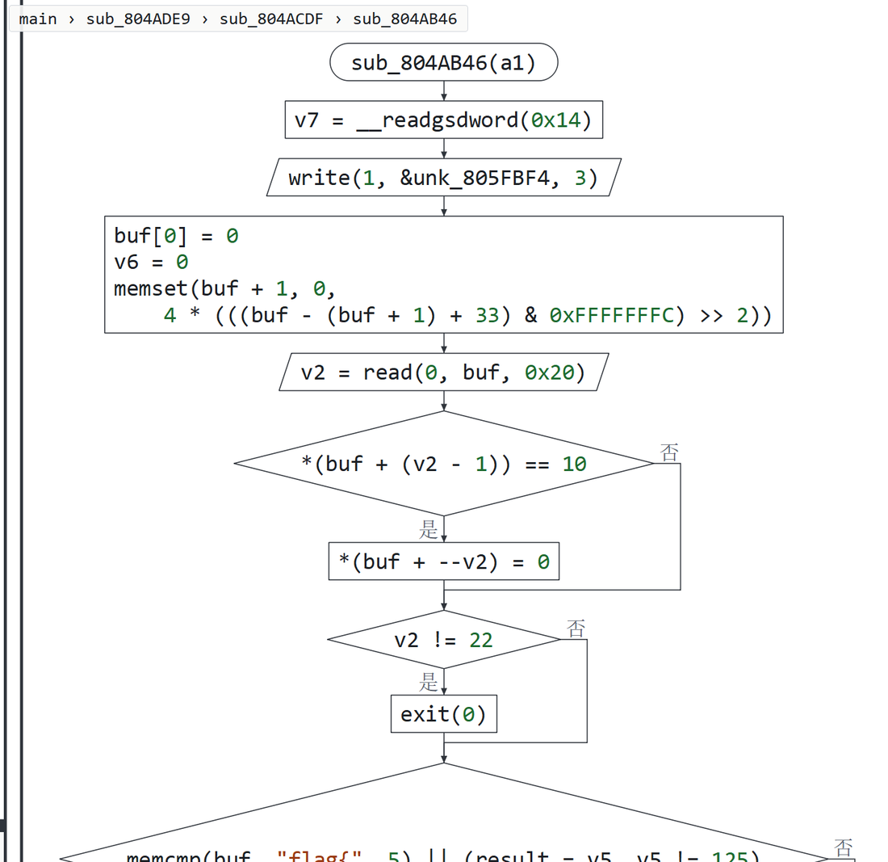

<div align="center">

# IDA Better Reverse

**认出去符号静态程序里的 libc 并命名，在伪代码里写明每个调用的含义，再把任意函数画成一张可以对着调用一层层放大进去的流程图。**

[](https://github.com/FPSZ/ida-better-reverse/releases/latest)
[](LICENSE)


[English](README.md) · 简体中文

</div>

<picture>
  <source srcset="docs/demo.zh-CN.avif" type="image/avif">
  
</picture>
<p align="center"><sub>IDA Pro 9.1，去符号的静态 x86-64 程序，一键完成（v2.2.0 录制）。<a href="https://github.com/FPSZ/ida-better-reverse/releases/download/v2.2.0/demo.zh-CN.mp4">MP4，1080p60</a> · 数据流与流程图见<a href="#数据流与流程图">单独的视频</a>。</sub></p>

IDA Better Reverse 是一个 IDA Pro 插件，面向 CTF 逆向、pwn 题和不少 Linux 恶意样本最常见的形态：去符号、静态链接。它判断程序里链进来的是哪个 C 运行库构建（glibc 或 musl，精确到发行版本），用为这个构建以及同时链入的 GCC 运行时专门生成的 FLIRT 签名给库函数命名，并在 Hex-Rays 输出里写明每个 libc 调用和系统调用在做什么。之后它帮你读程序自己的代码：单独看一个变量的数据流，或者把整个函数画成教科书式的流程图，对着某个调用放大，它就在原地展开成被调函数的流程图。插件是纯 Python，数据内置；入口文件不装 IDA 也能当命令行工具用。

## 命名与注释

### 从字节认出 libc 并命名

去符号的静态程序里，源码中的 `printf` 只剩一个 `sub_4776D0`。**检测**用各 glibc / musl 构建的函数字节指纹在程序里的命中比例给候选排序；**执行**套用为胜出构建及其 GCC 运行时生成的 FLIRT 签名，并给命名后的函数加上原型。在 Butterfly 上：glibc 2.39，一键命名 838 个函数，套用 143 个原型。

<p align="center"></p>

### 写明每个调用的含义

反编译器钩子在每个调用旁边写出它对实际传入的值做了什么：`open` 标志、`mmap` 权限（RWX 会标出）、信号、`ptrace` 请求、套接字类型、printf / scanf 每个格式符对应的参数、按架构命名的 `syscall(n)`。成串的 MMX / SSE / AVX 内建函数折叠成一个普通算式，并说明它和标量运算不同的地方（按通道、无进位）。注释在函数显示时绘制，不写入数据库。

<p align="center"></p>

## 数据流与流程图

<picture>
  <source srcset="docs/flow.zh-CN.avif" type="image/avif">
  
</picture>
<p align="center"><sub>IDA Pro 9.1 实录：先是 Butterfly（强网杯 2025），再在 xrtFuze（强网杯 2023）里连续放大三层。<a href="https://github.com/FPSZ/ida-better-reverse/releases/download/v2.4.0/flow.zh-CN.mp4">MP4，1080p60</a></sub></p>

### 单独看一个变量

在变量（或全局变量）上按 **Ctrl-Alt-F**，打开一个窗口，只留下它的值从哪里来（▲）、读写它的行（●）、它流向哪里（▼），以及包住这些行的 if / 循环头，其余全部隐藏。它能跟着值穿过内存：基于控制流的到达定义、按对象的指向分析、指针拷贝，以及通过参数写内存的调用（`fread`、`memcpy`、未知的 `encrypt(buf, out)`）。双击另一个变量改为跟踪它，Esc 返回。

<p align="center"></p>

### 把函数画成流程图

按 **空格**，窗口变成整个函数的流程图，画法和教科书一致：语句按顺序排列，条件是菱形、出口标是 / 否，输入输出是平行四边形，调用程序自己的函数用双竖边框，循环在左侧回跳、右侧退出，出错返回的分支单独放一列。运算写成算式（`v19 <<< 1`、`(每字节)`），不是内建函数名。当前变量标黄；它的来源标紫（▲），由它算出来的标蓝（▼），都只标在真正参与计算的那几行：来源在它所在行和上方，去向在下方。与它无关的行淡化，左上角有图例。单击某一步，亮出走到这一步的路径。

<p align="center">
  
  
</p>

### 对着调用放大，原地展开

程序自己的函数调用旁都有一个 ⊕。鼠标停在上面，会先弹出被调函数流程图的缩略图。对着调用放大，它的流程图就挂在调用下方展开；继续放大，里面的调用也能这样一层层打开，想钻多深都行。图例第一行的面包屑显示当前在哪一层。如果当前跟踪的值作为实参传了进去，被调函数里接收它的参数会接着点亮。放大到之前不反编译任何东西，每次事件循环只处理一个函数，缩小后释放。

<p align="center">
  
</p>
<p align="center">
  
  
</p>

## 评测

所有数字均用 IDA Pro 9.1（idalib 与图形界面）在 AMD Ryzen AI MAX+ 395 上实测。

### 函数命名与真值对比

两个小 C 程序用 Ubuntu 24.04 的 GCC 13.3、glibc 2.39 以 `-static` 编译出 x86-64、i386、AArch64 三个二进制，再去符号。签名套用到去符号版本，重复套用直到某一轮不再新增命名；每个名字都和未去符号版本同一地址上的全部符号比对（`read`/`__read`/`__libc_read` 这类别名算对）。覆盖率 = 命名正确数 / 未去符号版本符号表中的全部函数，精确率 = 命名正确数 / 命名总数。

| 二进制（函数数） | 仅 IDA | IDA 9.1 `ubuntu-libc6-dev` | IDA 9.1 `debian-libc6-dev` | 本项目，libc | 本项目，libc + libgcc |
|---|--:|--:|--:|--:|--:|
| x86-64（1,059） | 0 | 71.6% · 93.3% | 0.5% · 31.3% | 80.8% · 99.9% | **85.2% · 99.9%** |
| i386（993） | 0 | 18.1% · 87.4% | 64.8% · 90.7% | 78.9% · 99.9% | **86.4% · 99.9%** |
| AArch64（911） | 0 | 39.2% · 89.5% | 25.8% · 76.3% | 55.9% · 98.6% | **65.4% · 98.8%** |

<sub>每格为覆盖率 · 精确率。这些程序上 IDA 自己不会套用任何 libc 签名。IDA 自带签名把多个版本合在一起，该选哪个取决于发行版（x86-64 上 Ubuntu 的好得多，i386 上 Debian 的好），错误主要是长得像的短函数、`.cold` 片段和其他版本的代码。分母包括任何 libc 签名都无法命名的函数（`main`、程序自身代码、CRT 启动代码）。测试程序用的是 glibc 2.39，正是本项目签名所选的版本，IDA 的签名则覆盖多个版本。原始结果：`devtools/eval_flirt.py`。</sub>

### CTF 程序的运行库识别

强网杯 2023–2025 逆向题全部 19 个 ELF 与 PE 文件，共 63.6 MB：

| 类别 | 文件数 | 结果 |
|---|--:|---|
| 静态 x86-64 glibc | 5 | glibc 2.31、2.35（×3）、2.39，其中两个 ELF 头被篡改。四个带 GCC / Ubuntu 工具链字符串的，结果与之一致。 |
| 动态 ELF，含一个 41 MB 的共享库 | 7 | 判为动态，给出 `GLIBC_2.x` 下限 |
| Windows PE | 6 | 识别出 MSVC（Rich 头）、MinGW 与 .NET |
| 静态 MIPS | 1 | 报告不支持，不下结论 |

无一误判。命令行识别全部 19 个文件共用 2.0 秒。

### 真实题目上的流程图

对 7 道强网杯题各取最大的 40 个函数（共 238 个）画流程图，并对每个函数的每个变量（每函数最多 40 个，共 4,500 个）做跟踪：没有报错，没有两个图形重叠，没有连线穿过图形。最大的一张图有 2,089 行（语句和条件）；画图最长 1.0 秒，换跟踪变量最长 1.0 秒。测试集另用 150 个随机函数结构做同样的检查。放大展开在 xrtFuze 和 ez_vm（强网杯 2024，一个虚拟机解释器）上都测到了三层；生成一个被调函数的流程图用时 11–41 毫秒。

### 撤回

插件写入的所有改动（名称、类型、库函数标记、注释）都记入日志。在 36 个无界面配置（上面的文件、两种界面语言下的测试程序、真值二进制）上，**撤回**后插件写过的东西一样不剩；唯一的差异是 Hex-Rays 反编译时自己推断的类型。数据流和流程图窗口不写数据库。

## 原理

**指纹。** 每个架构 29 个构建（glibc 2.19–2.44、musl 1.1.24 与 1.2.2–1.2.6，取自 Ubuntu 和 Alpine 软件包），每个函数开头的 FLAIR 模式取一段 10–24 字节、不含通配的最长片段作为锚点。每个架构 1.2–1.4 万个锚点按各自最稀有的 8 字节窗口建索引，扫描可执行字节一遍，每个偏移只查一次字典。构建的得分是其锚点在程序中出现的比例；置信度看与第二名的差距，并与 `.comment` 里的工具链字符串交叉核对。静态 / 动态由程序头判断；被篡改的 `EI_CLASS` / `EI_DATA` 按能解出有效机器类型的布局解码。

**适配链接后代码的签名。** `pelf` 只把目标文件里重定位要填的字节通配，但静态链接改动得更多：

| 架构 | `libc.a` 中 | 链接后 | `pelf` 未通配的字节 |
|---|---|---|---|
| x86-64 | `mov rcx, [rip+__libc_errno@gottpoff]` &nbsp;`48 8B 0D` | `mov rcx, -0x40` &nbsp;`48 C7 C1` | REX、操作码、ModRM |
| AArch64 | `adrp x0, sym` &nbsp;模式 `......90` | `600400F0` | 最高字节（`immlo`） |
| AArch64 | `ldr x0, [x0, #:lo12:sym]` &nbsp;模式 `....40F9` | `002446F9` | `imm12` 高位 |
| i386 | `mov eax, [ebx+sym@GOT]` &nbsp;`8B 83` | `mov eax, imm32` &nbsp;`C7 C0` | 操作码、ModRM |

[`tools/flair_relax.py`](tools/flair_relax.py) 在 `sigmake` 之前把这些字节通配；固定字节不足 10 个的模式和字节完全相同的模块宁可不命名也不猜。GCC 运行时（`libgcc`、`libgcc_eh`、`crtbeginT.o`）为 GCC 4.8 到 15 单独生成签名，与 libc 签名一同套用。

**数据流。** Hex-Rays 的 ctree 先转成中立的语句树。每条语句是一个站点，记录它读写什么；到达定义以位集在控制流上计算；指向关系按站点计算，所以 `p = buf; *p = x` 写的是 `buf` 的内存。调用按它对参数做什么建模：`fread` 只写缓冲区，`memcpy` 是拷贝，未知调用可能写它拿到的内存。切片向后找来源，向前找去向。

**流程图。** 语句树转成结构化布局（顺序、if、循环、switch、break / continue、goto），按轮廓摆放：主线一路向下，以返回结束的分支（出错返回）放在条件旁边单独一列，循环在左侧闭合。连线绕开图形正交布线。被调函数的流程图挂在调用下方的面板里，按面板宽度缩放；调用被放大的程度决定它何时生成、淡入和释放。

## 安装

1. 从[最新发布页](https://github.com/FPSZ/ida-better-reverse/releases/latest)下载 `ida_better_reverse.zip` 和 `ibr-sigs.zip`。
2. 两个都解压到 IDA 用户目录（Windows 为 `%APPDATA%\Hex-Rays\IDA Pro\`，Linux / macOS 为 `~/.idapro/`）。会放入 `plugins/ida_better_reverse.py`、代码目录 `plugins/ida_better_reverse/`，以及 `sig/pc/`、`sig/arm/` 下的 117 个签名。
3. 重启 IDA。

需要 IDA Pro 7.4–9.x 与 Python 3（在 9.1 上开发和测试）。窗口使用 PyQt5（IDA 9.1 及以前）或 PySide6（9.2 及以后）。注释、数据流和流程图需要 Hex-Rays 反编译器；检测和 FLIRT 不需要。插件不发起任何网络连接。从 2.3 及以前版本升级：新的入口文件会替换旧的单文件 `ida_better_reverse.py`。

## 用法

| 位置 | 按键 | 作用 |
|---|---|---|
| 任意处 | **Ctrl-Alt-G** | 打开面板：**检测**、**执行**（签名、原型、注释）、**撤回** |
| 伪代码 | **Ctrl-Alt-F** 或右键 | 光标处变量的数据流 |
| 数据流窗口 | **空格** | 文字 ⇄ 流程图，原地切换 |
| 两种窗口 | 双击 · Esc · Ctrl-Enter · 鼠标侧键 | 跟踪变量 · 后退 · 前进 |
| 流程图 | 滚轮 · 拖动 | 以鼠标为中心缩放（可放大进调用）· 平移 |
| 流程图 | 单击 · Esc | 走到这一步的路径 · 回到变量高亮 |
| 流程图 | 双击函数名 · 回车 | 跳到该函数 · 跳到伪代码中的这一行 |

数据流窗口开着时，在伪代码里双击局部变量，窗口也会跟着切换。界面与注释支持中英文。

不装 IDA（在解压后的 `plugins/` 目录或仓库里）：

```console
$ python ida_better_reverse.py ./target                  # 候选排名与结论
$ python ida_better_reverse.py ./target --top 8 --json   # 机器可读输出
$ python ida_better_reverse.py ./target --repair out     # 修复被篡改的 EI_CLASS/EI_DATA，让 IDA 能载入
```

## 从源码构建

源码在 `src/ibr`：`core/`（检测、解码、布局，不引用 IDA）、`analysis/`（数据流、流程图）、`app/`（面向 `ports.py` 的用例）、`adapters/`（idaapi、Hex-Rays、Qt、命令行）。`python tools/package.py` 生成 `dist/ida_better_reverse.zip`；`python -m pytest tests` 不需要 IDA。指纹和签名用 Hex-Rays FLAIR 从公开软件包重建：`tools/build-db.py`、`build-fingerprint.py`、`make-sigs.py`。

## 局限

- 静态识别要求该构建在数据库中；其他发行版用不同参数编译的库匹配度会下降。动态程序只给出下限。
- 运行库识别和签名覆盖 x86-64、i386、AArch64。AArch64 上，多函数目标模块里的后续函数只有在模块首个函数匹配时才会命名。
- 与其他函数字节完全相同的库函数不命名。
- 数据流以函数为单位：经由全局变量、或由其他函数存进内存的指针在函数之间传递的值，不跨调用跟踪。
- 展开的调用面板会盖住调用下方的那部分流程图，缩小即恢复。

## 许可

代码采用 [MIT](LICENSE)。指纹与签名用 Hex-Rays FLAIR 从公开的 Ubuntu、Alpine 软件包生成：

| 库 | 软件包 | 许可 |
|---|---|---|
| glibc | `libc6-dev`、`libc6-dev-i386` | LGPL-2.1-or-later |
| musl | `musl-dev` | MIT |
| GCC 运行时 | `libgcc-N-dev`、`lib32gcc-N-dev` | GPL-3.0，附 GCC 运行库例外条款 |

其中只有函数名、校验和与短字节模式：每个函数开头 32 字节（重定位字节已通配），两函数冲突时附加少量区分字节；指纹中每个函数一段 10–24 字节。不再分发任何库或完整函数；不包含 FLAIR。灵感来自社区 FLIRT 合集 [`push0ebp/sig-database`](https://github.com/push0ebp/sig-database)，但未使用其数据。
